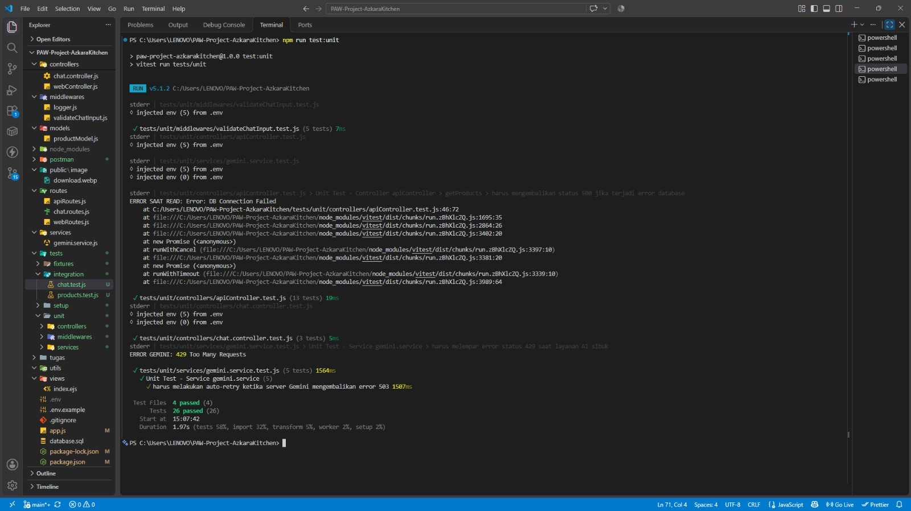
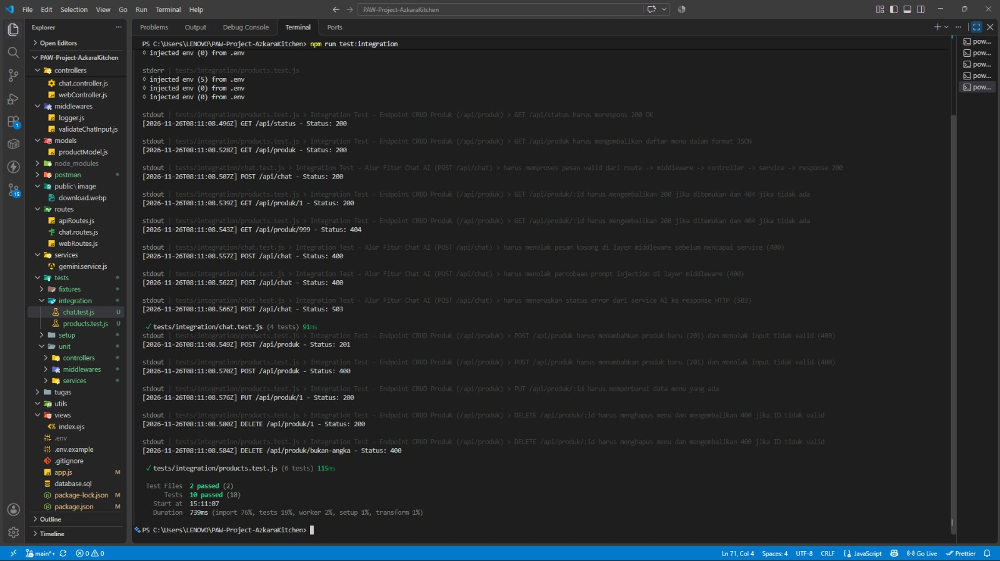
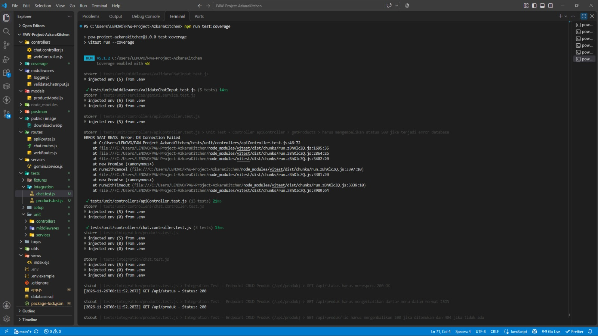
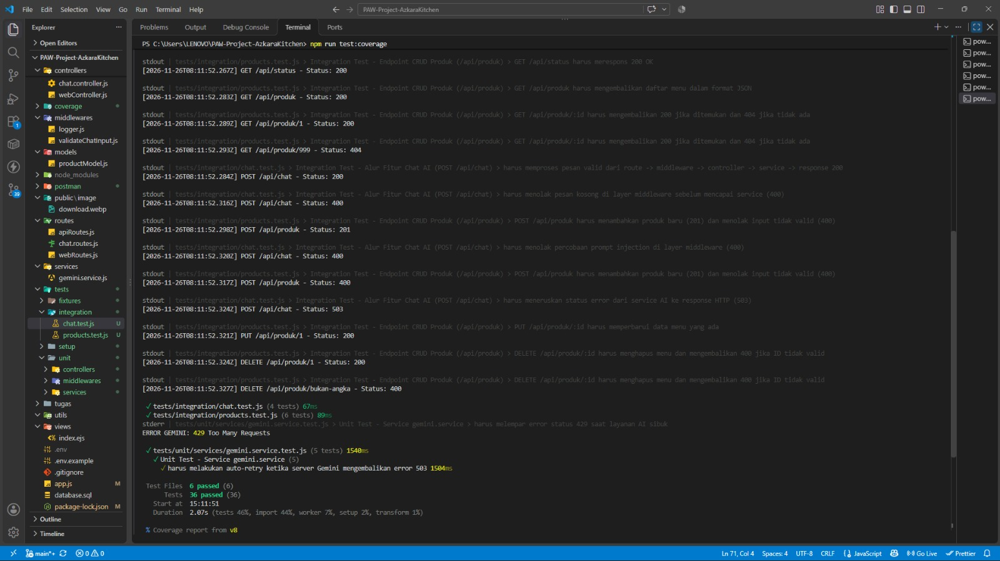
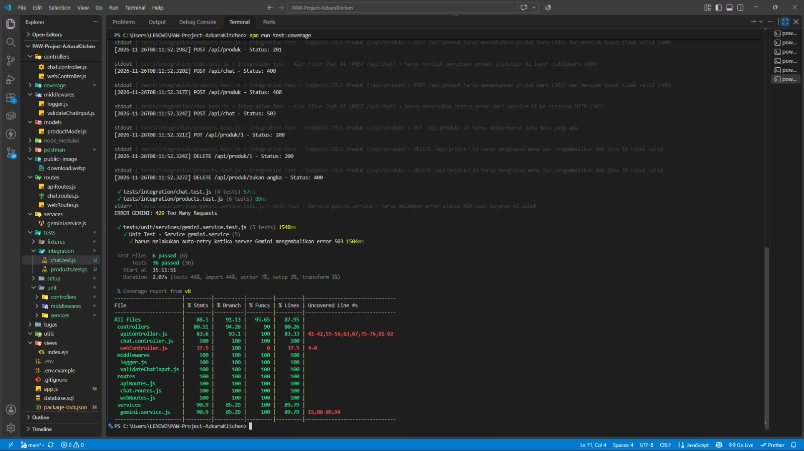

# Tugas Week 11 — Unit Testing, Integration Testing & Code Coverage
**Project:** Azkara Kitchen (`PAW-Project-AzkaraKitchen`)

## 1. Unit Testing (`npm run test:unit`)

## 2. Integration Testing (`npm run test:integration`)

## 3. Code Coverage (`npm run test:coverage`)

